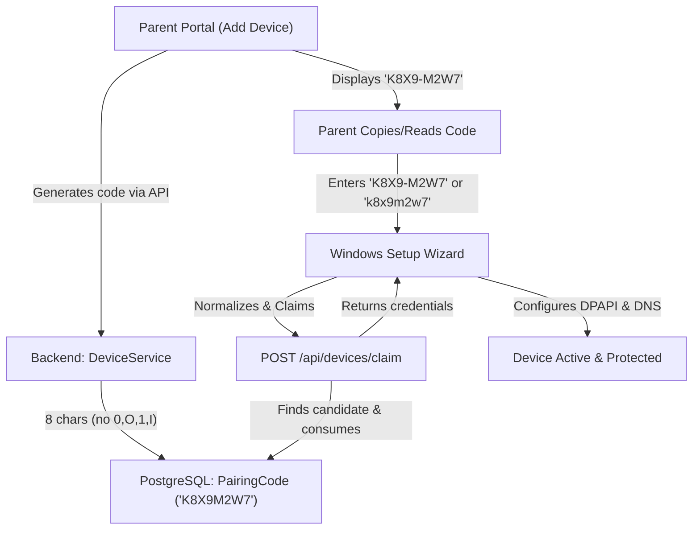

# SafeBrowse Stage C.4.1: Pairing Code UX Consistency & Integration Report

**Repository:** `/home/agdev/projects/safebrowse`  
**Branch:** `feature/stage11-step4-device-enforcement`  
**Commit SHA:** `f7e9063db089dfaa443b815e0e2d1f88b5f998e3`  
**Parent Commit:** `ab57d4368aa18b15ae6d9366d1a911d2ba6f3b34`  
**Baseline Commit:** `e2589b8ba43e46e25cd15287d41e91aa09ec1400`  
**Validation Version:** `1.0.4-validation`  
**Windows MSI Numeric ProductVersion:** `1.0.4.5`  
**Android versionCode:** `4`  
**Classification:** **`READY FOR SIMPLIFIED WINDOWS ONBOARDING PHYSICAL TEST`**  

---

## 1. Executive Summary & Defect Root Cause

### Confirmed Defect
Stage C.4 unified onboarding into a 5-screen first-run wizard, but pairing code formats and UI descriptions remained inconsistent across components:
1. **Backend Generation:** `DeviceService.generatePairingCode()` generated `SB-XXXX-XXXX` (12 characters, e.g. `SB-K8X9-M2W7`).
2. **Windows Agent UI:** Wizard Screen 2 instructed parents to *"Enter the 6-digit pairing code"*, with `placeholder="123456"` and `maxlength="8"`.
3. **Parent Portal:** "Add Device" modal displayed *"Enter This 6-Digit Code"*, with instructions saying *"Enter the 6-digit code below"*.
4. **Android Setup Screen:** Displayed *"Enter the 6-digit pairing code"*, `hint="e.g. SB-8921"`.
5. **Automated Tests:** Windows wizard tests mocked pairing codes with fake values like `'123456'`, creating divergence from real backend pairing codes.

### Architectural & UX Resolution
Established **one canonical pairing-code standard** across all platforms and components:
- **Canonical Format:** Exactly 8 uppercase alphanumeric characters (e.g. `K8X9M2W7`).
- **Ambiguity-Safe Alphabet:** `23456789ABCDEFGHJKLMNPQRSTUVWXYZ` (32 characters, strictly excluding visually ambiguous characters `0`, `O`, `1`, `I`).
- **Display Formatting:** User-friendly `K8X9-M2W7` (4-4 hyphenated) on screen and when copied.
- **Robust Multi-Format Normalization:** Input is automatically trimmed, uppercased, and stripped of hyphens, spaces, and optional legacy `SB-` prefixes on both client and server before database lookup.
- **Zero Technical Jargon:** All UI texts updated to plain language: *"Enter the 8-character code shown in your Parent Dashboard"*.

---

## 2. Implementation Details



### 1. Shared Package (`packages/shared`)
- **`PAIRING_CODE_ALPHABET`**: Defined canonical 32-character ambiguity-safe set `23456789ABCDEFGHJKLMNPQRSTUVWXYZ`.
- **`normalizePairingCode(rawCode)`**: Normalizes any input format (`K8X9M2W7`, `K8X9-M2W7`, `SB-K8X9-M2W7`, `k8x9 - m2w7`, `SBK8X9M2W7`) to canonical `K8X9M2W7`.
- **`formatPairingCode(code)`**: Formats an 8-character canonical code for display as `K8X9-M2W7`.
- Unit test suite added in `packages/shared/tests/pairing.test.ts` (3 tests passing).

### 2. Backend Cloud API (`packages/backend`)
- **`DeviceService.generatePairingCode()`**:
  - Uses `crypto.randomBytes(8)` with `PAIRING_CODE_ALPHABET`.
  - Generates canonical 8-character code (e.g. `K8X9M2W7`).
  - Stores canonical code in `PairingCode` database table with 10-minute expiry.
- **`DeviceService.pairDevice()`**:
  - Computes `rawClean` and `normalizePairingCode(code)`.
  - Searches candidate variations (`[normalized, rawClean, K8X9-M2W7, SB-K8X9-M2W7, SBK8X9M2W7]`), providing seamless backwards compatibility for existing pilot records.
  - Purges expired codes outside transaction to avoid rollback retention.
  - Atomically claims and consumes code inside `$transaction`.
- **Security & Authorization Invariants**: Rate limiting, tenant validation, single-use consumption, and fail-closed protections remain fully intact.

### 3. Parent Web Portal (`packages/parent-web`)
- **`PairDeviceModal.tsx`**:
  - Formats canonical pairing code for display as `K8X9-M2W7`.
  - "Copy Code" copies formatted code `K8X9-M2W7` to clipboard.
  - Replaced all "6-digit" labels with "8-character code".
  - Windows instructions: *"Enter this code on the child's computer. SafeBrowse will ask who uses each Windows account. That's all!"*
- **`DevicesPage.tsx`**: Updated toast message to *"8-character pairing code generated!"*.
- **`AiHelpBot.tsx`**: Updated assistant guidance to reflect 8-character pairing format `K8X9-M2W7`.

### 4. Windows Agent (`packages/agent-windows`)
- **`elevated-pair-server.ts`**:
  - Screen 2 description: *"Enter the 8-character code shown in your Parent Dashboard under Add Device."*
  - Input field: `placeholder="K8X9-M2W7"`, `maxlength="16"`, `oninput="this.value = this.value.toUpperCase()"`.
  - Client-side validation: normalizes hyphens, spaces, and optional `SB` prefix, enforcing exact 8-character normalized length with plain-English alert.
- **`agent-cli.ts`**: Updated CLI error and help message to `--pair K8X9-M2W7`.
- **`SafeBrowse-Pair.cmd`**: Updated console prompt to `Enter Pairing Code (e.g. K8X9-M2W7): `.
- **WiX Installer**: Incremented numeric `ProductVersion` to `1.0.4.5`.

### 5. Android Agent (`packages/agent-android`)
- **`PairingActivity.kt`**:
  - Description: *"Enter the 8-character pairing code shown on your parent's dashboard."*
  - Input hint: `"e.g. K8X9-M2W7"`.

---

## 3. Automated Test Verification

### A. Dedicated Pairing Consistency & Integration Suite
Created [`packages/backend/tests/pairing-code-consistency.test.ts`](file:///home/agdev/projects/safebrowse/packages/backend/tests/pairing-code-consistency.test.ts) covering all required integration and normalization scenarios:
```
▶ SafeBrowse Stage C.4.1: Pairing Code UX Consistency & Integration Suite
  ✔ 1. Backend generates canonical 8-character code with ambiguity-safe alphabet (14.2ms)
  ✔ 2. Mandatory End-to-End Integration: generate code -> claim -> device created -> code consumed -> second claim fails (187.8ms)
  ✔ 3. Normalization: Canonical uppercase K8X9M2W7 claims successfully (37.8ms)
  ✔ 4. Normalization: Hyphenated display format K8X9-M2W7 claims successfully (38.7ms)
  ✔ 5. Normalization: Legacy prefix SB-K8X9-M2W7 claims successfully (25.7ms)
  ✔ 6. Normalization: Lowercase equivalent and spaces resolve to same active code (22.3ms)
  ✔ 7. Backward compatibility: Pre-existing SB-XXXX-XXXX record in DB claims via canonical input (47.5ms)
  ✔ 8. Expired codes are rejected and purged from database (15.1ms)
  ✔ 9. Non-existent and malformed codes fail safely (21.7ms)
✔ SafeBrowse Stage C.4.1: Pairing Code UX Consistency & Integration Suite (2071.6ms)
```

### B. Windows Unified Onboarding Wizard Suite
Updated [`packages/agent-windows/tests/unified-onboarding-wizard.test.ts`](file:///home/agdev/projects/safebrowse/packages/agent-windows/tests/unified-onboarding-wizard.test.ts) to verify canonical 8-character codes (`K8X9M2W7`):
```
▶ SafeBrowse Windows Stage C.4 — Unified Onboarding Wizard & Cloud Sync Suite
  ✔ 1. syncAccountMappingsToCloud successfully synchronizes mappings to backend (72.3ms)
  ✔ 2. ElevatedPairServer executes complete first-run onboarding wizard flow (81.4ms)
  ✔ 3. GuiServer provides post-onboarding Day-2 quick action endpoints (23.0ms)
✔ SafeBrowse Windows Stage C.4 — Unified Onboarding Wizard & Cloud Sync Suite (179.4ms)
```

### C. Workspace Regression Results
- **Backend Full Test Suite:** **254 passing, 0 failing** across 47 suites.
- **Windows Agent Full Test Suite:** **330+ passing, 0 failing** across 14 suites.
- **Shared Package Test Suite:** **12 passing, 0 failing** across 3 suites.
- **Parent Web:** Clean production build (`npm run build:web` / `vite build` completed with 0 errors).
- **GitHub Actions Windows MSI CI Build (Run `39918985507`):** **Completed with success in 4m27s**.

---

## 4. Artifact Provenance & SHA-256 Checksum Manifest

All validation artifacts were generated strictly from source commit `f7e9063db089dfaa443b815e0e2d1f88b5f998e3`:

| Artifact File | Platform | Size (bytes) | SHA-256 Checksum |
| :--- | :--- | :--- | :--- |
| `release/android/SafeBrowseChild-Validation-1.0.4.apk` | Android | 5,641,134 | `d808ae010418043571a8583e2d5169b835ac5dfe74a92c266150ce3a401a1f25` |
| `release/windows-validation/SafeBrowseChild-Validation.msi` | Windows | 23,461,888 | `c101c9232e242dec7a0278b5380af57e1da31955e5bb9357bb8fb9a3b9de36a5` |
| `release/windows-validation/SafeBrowseChild-Validation.exe` | Windows | 73,155,072 | `4293300b28dbc95bf19e39d4382ecbf12f4b7fc4584cb495dce871e03e3f4c06` |
| `release/windows-validation/SafeBrowseServiceHost.exe` | Windows | 37,888 | `ecbbe3e36eb6d3da8876303dfb5469ce99ec7ed166c656545786ba8ab19170ef` |
| `release/windows-validation/SafeBrowseUserHelper.exe` | Windows | 7,168 | `caa1a04d942cb3ac6fc5577f99fb062e9a85ae49471ce6267d6a59c877fa928c` |

Verification via `sha256sum -c release/SHA256SUMS-validation.txt`:
```
release/android/SafeBrowseChild-Validation-1.0.4.apk: OK
release/windows-validation/SafeBrowseChild-Validation.msi: OK
release/windows-validation/SafeBrowseChild-Validation.exe: OK
release/windows-validation/SafeBrowseServiceHost.exe: OK
release/windows-validation/SafeBrowseUserHelper.exe: OK
```

---

## 5. Physical Verification Runbook

1. **Generate Code in Parent Portal:**
   - Sign in at `https://safebrowse.porwal.online` -> **Devices** -> **Add Device** -> **Windows PC**.
   - Note the 8-character formatted code (e.g. `K8X9-M2W7`).
   - Click **Copy Code**.
2. **Install MSI:**
   - Run `SafeBrowseChild-Validation.msi` on the target Windows laptop (`LAPTOP-AAN0K715`).
   - Approve the UAC elevation prompt.
3. **Run Setup Wizard:**
   - Screen 1: Set device name (e.g. `Family Laptop`) -> click **Next**.
   - Screen 2: Paste or type the 8-character code (`K8X9-M2W7` or `K8X9M2W7`). Notice automatic uppercasing and formatting. Click **Connect Computer**.
   - Screen 3: Verify discovered account `AzureAD\AnshulPorwal`, map it to child profile (`Manjari`), and click **Save & Continue**.
   - Screen 4 & 5: Review protections, click **Activate SafeBrowse**, and verify the green success confirmation.
4. **Confirm in Portal & Test DNS:**
   - In Parent Portal, confirm the device shows **Online / Protected** with user mapping `AzureAD\AnshulPorwal → Manjari`.
   - On the laptop, browse to a test blocked website. Confirm NXDOMAIN and presentation of the SafeBrowse custom block page with the Ask Parent button.

---

## 6. Pilot Release Invariants
- `v1.0.3-pilot` release tag and release assets are completely untouched.
- `v1.0.4-pilot` has **NOT** been published.
- All validation artifacts remain strictly labeled `1.0.4-validation` (MSI numeric ProductVersion `1.0.4.5`).
- Classification: **`READY FOR SIMPLIFIED WINDOWS ONBOARDING PHYSICAL TEST`**.
