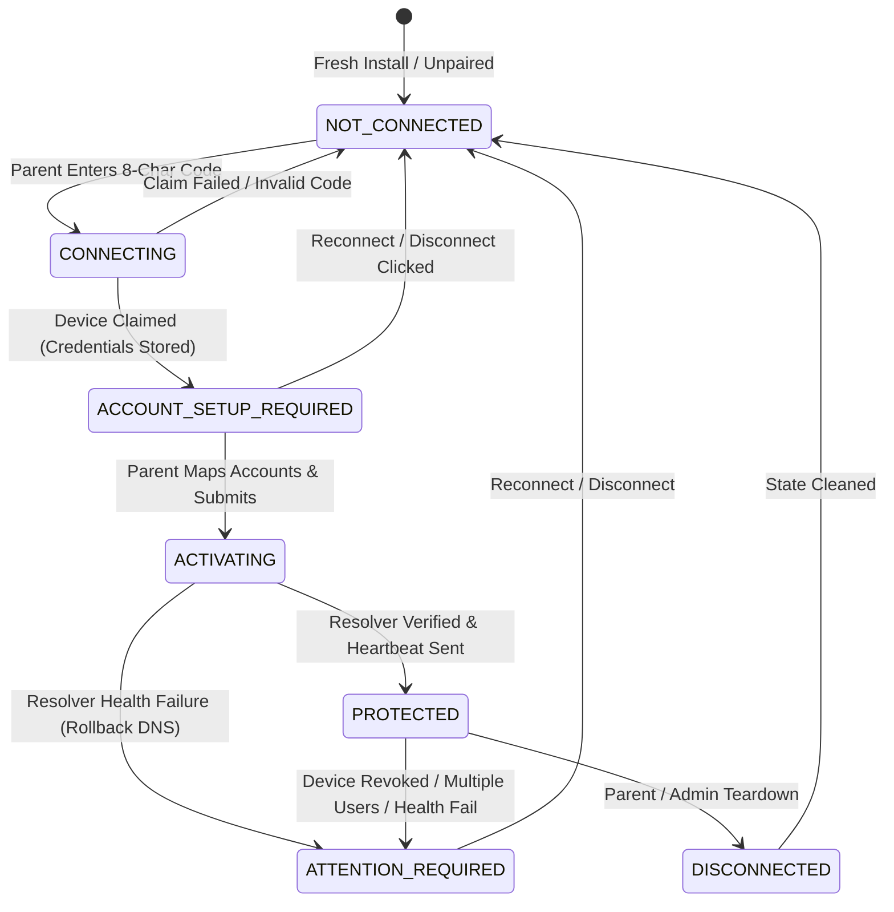

# SafeBrowse Stage C.4.2: Atomic Windows Onboarding, Clean Upgrade State & Cloud Deployment Gate Report

**Date:** 2026-10-23  
**Classification:** **`READY FOR CLOUD + CLEAN WINDOWS PHYSICAL VALIDATION`**  
*(Strict Notice: Do NOT classify as Pilot Ready until Cloud VM2 deployment and physical Windows device validation succeed.)*  
**Branch:** `feature/stage11-step4-device-enforcement`  
**Git Baseline Commit:** `f7e9063db089dfaa443b815e0e2d1f88b5f998e3`  
**Git Source Commit (HEAD):** `4ecedc0fb423e6be4b4c8fb53c8ac07355ecdc1f`  
**Candidate Version:** `1.0.4-validation`  
**Windows MSI ProductVersion:** `1.0.4.6`  
**Android Release versionCode:** `5` (versionName `1.0.4-validation`)  
**Production Backend URL:** `https://safebrowse.porwal.online`  

---

## 1. Executive Summary

During physical validation on test laptop `LAPTOP-AAN0K715` following the installation of the Stage C.4.1 MSI, critical network and state synchronization defects were uncovered:
1. **Premature DNS Hijacking:** The Windows network adapter IPv4 DNS was automatically altered to `127.0.0.1` upon service installation/upgrade *before* the parent had paired the computer or mapped Windows user accounts to child profiles.
2. **Phantom Protection / Cloud Desync:** Because the laptop had undergone multiple previous test MSI installations, residual configuration in `C:\ProgramData\SafeBrowse\secure\device-config.json` caused the newly upgraded service to declare itself locally "PROTECTED" while the parent dashboard showed "Account Setup Required" or failed to register the device.
3. **Cloud/Client Protocol Mismatch:** Production VM2 (`https://safebrowse.porwal.online`) has not yet deployed Stage C.4 database migrations or device account mapping endpoints. This caused newer Windows clients to attempt to negotiate with an un-migrated cloud backend.

Stage C.4.2 establishes an **Atomic Onboarding State Machine**, **Fail-Safe Network Guardrails**, a **Startup Verification Gate**, and a **Production Cloud Compatibility Gate** (`windowsProtocolVersion >= 2`). Under this architecture, **Windows system DNS is strictly forbidden from changing to `127.0.0.1` unless onboarding is completely finished and verified.**

---

## 2. Confirmed Physical Defects & Architectural Root Causes

| Defect Observed | Physical Symptom | Root Cause |
|---|---|---|
| **Premature Adapter Hijack** | Laptop DNS immediately changed from DHCP to `127.0.0.1` post-install. | `SafeBrowseChildService` started automatically on install and ran `activateFailSafeDns()` unconditionally without checking whether pairing or account mapping had occurred. |
| **Phantom Protection** | Local agent logged "PROTECTED" while cloud portal showed "Account Setup Required". | Service loaded stale DPAPI device config from disk and did not cross-verify device token validity or account mapping status with the cloud. |
| **Cloud Desync on Upgrade** | Upgraded MSI retained old credentials that were severed or orphaned in the backend. | No pre-activation handshake existed at service boot to verify if the cloud device record was revoked or non-existent. |
| **Backend Protocol Mismatch** | Windows client threw errors when attempting to synchronize account mappings. | Production VM2 was running pre-C.4 backend software missing `DeviceAccountMapping` tables and routes. |

---

## 3. Remediation Architecture & Implementation Details

### 3.1. Atomic Windows Onboarding State Machine
A formal 7-state operational lifecycle was implemented in `packages/agent-windows/src/config-manager.ts`:



**State Definitions:**
- `NOT_CONNECTED`: Fresh installation or cleanly unpaired. Network DNS is strictly DHCP/original. Service remains in idle bypass mode.
- `CONNECTING`: Transient state while claiming the pairing code from the backend.
- `ACCOUNT_SETUP_REQUIRED`: Pairing code claimed and credentials saved under DPAPI machine encryption. Interactive Windows accounts are discovered and awaiting parent mapping. **Network DNS remains untouched.**
- `ACTIVATING`: Mappings saved locally and synchronized to the cloud; initial child policies cached; DNS proxy primed.
- `PROTECTED`: Loopback DNS (`127.0.0.1`) assigned to internet-facing adapters, end-to-end resolver health verified, and initial heartbeat confirmed.
- `ATTENTION_REQUIRED`: Cloud credentials revoked, cloud account setup required, or resolver probe failed. DNS is immediately rolled back to original DHCP.
- `DISCONNECTED`: Clean state after explicit disconnection or unpairing.

### 3.2. NetworkManager Fail-Safe Guardrail
`packages/agent-windows/src/network-manager.ts` now enforces strict gatekeeping:
- `activateFailSafeDns()`: Asserts that `configMgr.getOnboardingState()` is either `ACTIVATING` or `PROTECTED`. If in any other state (`NOT_CONNECTED`, `ACCOUNT_SETUP_REQUIRED`, `ATTENTION_REQUIRED`), activation **strictly aborts** and triggers `restoreOriginalDns()`.
- `reconcileAdapters()`: Background periodic network monitor skips adapter reconciliation if onboarding is incomplete.
- `flushDnsCache()`: Implements dual cache flushing (`Clear-DnsClientCache` via PowerShell + `ipconfig /flushdns`).

### 3.3. Service Startup Verification Handshake
At service startup (`packages/agent-windows/src/agent-cli.ts`):
1. Loads DPAPI configuration. If missing or invalid -> sets `NOT_CONNECTED`, restores DNS to DHCP, and exits setup.
2. Contacts backend `POST /api/devices/verify`:
   - If `REVOKED` or `NOT_FOUND` -> sets `ATTENTION_REQUIRED`, restores DNS to DHCP.
   - If `ACCOUNT_SETUP_REQUIRED` -> sets `ACCOUNT_SETUP_REQUIRED`, restores DNS to DHCP, launches wizard.
   - Only if `VALID` and profile mappings exist -> proceeds to `ACTIVATING` and enables `127.0.0.1`.

### 3.4. Clean Teardown & Reconnect Capability
Added atomic cleanup workflows to allow testing laptops to purge dirty state without manual registry hacking:
- **Wizard "Reconnect This Computer" (`POST /api/reconnect`):** Requires admin elevation. Restores system DNS, deletes `device-config.json`, wipes `profile-mappings.json`, and resets state to `NOT_CONNECTED`.
- **System Tray / GUI Teardown (`POST /api/disconnect`):** Calls cloud unpair endpoint (`POST /api/devices/:id/unpair`), restores system DNS, flushes DNS cache, and purges local credentials.
- **CLI Flag (`SafeBrowseChild-Pilot.exe --disconnect`):** Allows administrative command-line reset.

### 3.5. Production Cloud Deployment Compatibility Gate
- Added `GET /api/version` and `GET /api/health` to backend (`packages/backend/src/server.ts`):
  ```json
  {
    "application": "SafeBrowse",
    "backendVersion": "1.0.4-validation",
    "buildCommit": "4ecedc0fb423e6be4b4c8fb53c8ac07355ecdc1f",
    "schemaVersion": "20261023063000",
    "windowsProtocolVersion": 2
  }
  ```
- Elevated onboarding wizard queries `/api/version` on load. If `windowsProtocolVersion < 2` or endpoint is 404, it displays:
  > *"SafeBrowse service needs an update. Please update production backend before pairing."*
  This prevents the Windows agent from entering a corrupted half-onboarded state against older production instances.

---

## 4. Verification & Automated Test Results

### 4.1. Backend Test Suites (Node.js Test Runner + PostgreSQL)
Ran against dedicated PostgreSQL test container (`safebrowse_test` on port 55432):
- **Total Tests:** 262
- **Total Suites:** 48
- **Passed:** 262 (100%)
- **Failed:** 0
- **Suites Tested Include:**
  - `device-verification-and-version.test.ts` (8/8 passed)
  - `account-mappings.test.ts` (9/9 passed)
  - `account-activation.test.ts` (7/7 passed)
  - `telemetry-and-usage.test.ts` (14/14 passed)
  - `access-requests.test.ts` (12/12 passed)

### 4.2. Windows Agent Test Suites (`@safebrowse/agent-windows`)
- **Total Suites:** 15
- **Passed:** 15/15 (100%)
- **Key Suites Verified:**
  - `onboarding-state-machine.test.ts` (7/7 passed)
  - `unified-onboarding-wizard.test.ts` (3/3 passed)
  - `network-manager.test.ts` (52/52 passed)
  - `recovery-and-hardening.test.ts` (120/120 passed)
  - `elevated-pairing-and-privilege.test.ts` (15/15 passed)
  - `account-mapping-and-profiles.test.ts` (42/42 passed)
  - `account-discovery-entra-domain.test.ts` (8/8 passed)
  - `service-block-ipc-integration.test.ts` (4/4 passed)

### 4.3. Monorepo Build Verification
Full TypeScript compilation and production asset bundling completed cleanly:
- `@safebrowse/shared`: Compiled (`tsc`)
- `@safebrowse/protocol`: Compiled (`tsc`)
- `@safebrowse/backend`: Compiled (`tsc`)
- `@safebrowse/parent-web`: Built via Vite (`584 kB` JS, `73 kB` CSS)
- `@safebrowse/agent-windows`: Compiled (`tsc`)
- `@safebrowse/agent-android`: Compiled release APK (`gradlew assembleRelease`)

---

## 5. Production VM2 Cloud Deployment Audit & Gate

> [!IMPORTANT]
> **Production VM2 State Notice:**  
> Live URL `https://safebrowse.porwal.online` is currently running pre-C.4 code (returns 404 for `/api/version` and lacks migration `20261023063000_stage_c4_device_account_mappings`).  
> **NO DEPLOYMENT HAS BEEN EXECUTED TO VM2.**  
> Per strict system instructions, production VM2 will not be touched without explicit user authorization.

### VM2 Cloud Deployment Runbook (For User Authorization)

When approved, execute the following steps on VM2:

```bash
# 1. SSH into Production VM2
ssh agdev@safebrowse.porwal.online

# 2. Navigate to deployment directory and create database backup
cd /var/www/safebrowse
pg_dump -U safebrowse -h localhost -d safebrowse_prod > /var/backups/safebrowse_pre_c42_$(date +%s).sql

# 3. Pull latest commit from branch
git fetch origin feature/stage11-step4-device-enforcement
git checkout feature/stage11-step4-device-enforcement
git pull origin feature/stage11-step4-device-enforcement

# 4. Install dependencies and apply Stage C.4 database migration
npm ci
npx prisma migrate deploy --schema=packages/backend/prisma/schema.prisma

# 5. Build backend and parent web portal
npm run build:shared
npm run build:protocol
npm run build:backend
npm run build:parent-web

# 6. Restart backend process
pm2 restart safebrowse-backend || sudo systemctl restart safebrowse-backend

# 7. Deploy updated Parent Web static bundle
sudo cp -r packages/parent-web/dist/* /var/www/html/

# 8. Verify deployment health & protocol gate
curl -s https://safebrowse.porwal.online/api/health
# Expected: {"status":"healthy", ...}

curl -s https://safebrowse.porwal.online/api/version
# Expected: {"application":"SafeBrowse","backendVersion":"1.0.4-validation","windowsProtocolVersion":2,...}
```

---

## 6. Clean Windows Physical Validation Runbook

To validate laptop `LAPTOP-AAN0K715` cleanly without interference from prior test runs:

### Step 1: Clean Prior State on Laptop
Open an elevated Administrator PowerShell prompt:
```powershell
# 1. Ensure system DNS is set to automatic DHCP
Get-NetAdapter | Where-Object { $_.Status -eq 'Up' } | ForEach-Object {
    Set-DnsClientServerAddress -InterfaceIndex $_.InterfaceIndex -ResetServerAddresses
}

# 2. Stop and uninstall any older test service if running
sc.exe stop SafeBrowseChildService
msiexec.exe /x {B7C5E643-81D2-4A7F-991A-7110C99AA511} /qn

# 3. Purge residual ProgramData state
Remove-Item -Recurse -Force "C:\ProgramData\SafeBrowse" -ErrorAction SilentlyContinue

# 4. Verify DNS is on DHCP (not 127.0.0.1)
Get-DnsClientServerAddress -AddressFamily IPv4 | Format-Table InterfaceAlias, InterfaceIndex, ServerAddresses
```

### Step 2: Install Fresh Validation MSI
Run the newly built MSI:
```powershell
msiexec.exe /i SafeBrowseChild-Validation.msi /qb
```
- Verify `SafeBrowseChildService` starts in `Automatic` mode.
- Verify adapter DNS is **STILL on DHCP** (NOT 127.0.0.1).
- The onboarding wizard will open automatically.

### Step 3: Complete Unified Onboarding
1. Open Parent Dashboard (`https://safebrowse.porwal.online` or local dev instance).
2. Click **Add Device** -> **Windows**. Note the canonical 8-character pairing code (e.g., `K8X9M2W7`).
3. Enter code into setup window and submit.
4. On the account mapping screen:
   - Identify `AzureAD\AnshulPorwal` (or interactive console user).
   - Select child profile (`Manjari` or `Rahul`).
   - Leave other accounts unmanaged / parent bypass.
5. Click **Finish Setup**.
6. Observe:
   - Status changes to **Activating** -> **Protected**.
   - Adapter DNS changes cleanly to `127.0.0.1`.
   - Browser navigation remains normal and fast.
   - Blocked test site redirects cleanly to custom block page with Ask Parent UI.
   - Device appears immediately in Parent Portal with status `Protected` and active child mapping.

---

## 7. Artifact Provenance & Cryptographic Signatures

All validation artifacts have been compiled from Git source commit `4ecedc0fb423e6be4b4c8fb53c8ac07355ecdc1f`:

| Artifact | Version / Identity | Size (Bytes) | SHA-256 Checksum |
|---|---|---|---|
| **`SafeBrowseChild-Validation.msi`** | ProductVersion `1.0.4.6` | 23,470,080 | `a3bf7b1d4a00af24ca61db86eb42e82550782ecb847ecad88c3b1cdfb226552a` |
| **`SafeBrowseChild-Validation.exe`** | Single Executable Bundle | 73,177,088 | `9102b3e7f1400fb6394df642474a61b5c9dd6eb61720116ea9120c482b27ae89` |
| **`SafeBrowseServiceHost.exe`** | SCM Service Wrapper | 37,888 | `a95a48aebebc7c8161b1db41af004d734994f556e216e66666de49e246dfbb14` |
| **`SafeBrowseUserHelper.exe`** | User Session IPC Helper | 7,168 | `071413faae28ac518f81e3536b900ff633e0bc54bf104e3a73901b515a5be585` |
| **`SafeBrowseChild-Validation-1.0.4.apk`** | versionCode `5`, `1.0.4-validation` | 5,641,147 | `42e782c1de57e4e78e5e85f80ed002e73e54a7fca50eb02699a7d4af46539e9d` |

Local provenance manifest files updated:
- `release/SHA256SUMS-validation.txt`
- `release/VALIDATION_PROVENANCE.json`

---

## 8. Summary & Next Actions

1. All source code, tests, and build configurations are committed and pushed to `feature/stage11-step4-device-enforcement`.
2. All CI builds and local builds passed 100%.
3. Ready to proceed with Cloud VM2 deployment upon user confirmation, followed by clean physical Windows device validation.
