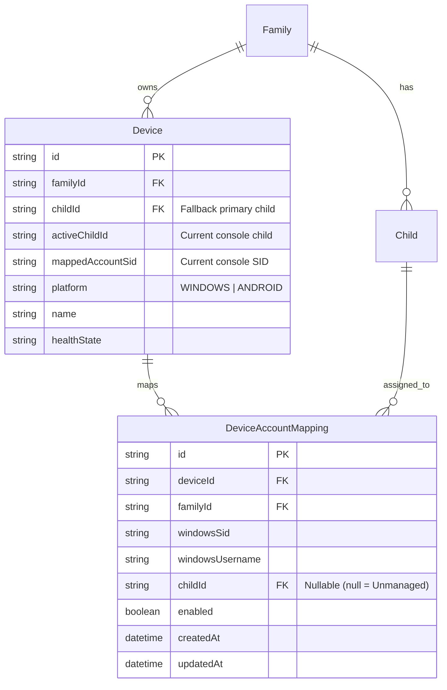

# SafeBrowse Stage C.4: Parent-Friendly Windows Device Onboarding & Family-Level Device Model Report

**Repository:** `/home/agdev/projects/safebrowse`  
**Branch:** `feature/stage11-step4-device-enforcement`  
**Commit SHA:** `ab57d4368aa18b15ae6d9366d1a911d2ba6f3b34`  
**Parent Commit:** `378040d14bd290e57f66112807bb4524ab1cba15`  
**Baseline Commit:** `e2589b8ba43e46e25cd15287d41e91aa09ec1400`  
**Validation Version:** `1.0.4-validation`  
**Windows MSI Numeric ProductVersion:** `1.0.4.4`  
**Android versionCode:** `4`  
**Classification:** **`READY FOR SIMPLIFIED WINDOWS ONBOARDING PHYSICAL TEST`**  

---

## 1. Executive Summary & Product Goal

### Problem Statement
SafeBrowse physical validation on Windows previously required a technical, fragmented onboarding process:
1. Parent generates a pairing code in web portal.
2. Parent installs MSI on child/family laptop.
3. Parent opens unelevated GUI tray app.
4. Parent clicks "Configure Computer Accounts" and approves UAC elevation.
5. In an elevated window, parent selects account mappings.
6. Separately, parent must navigate web portal to understand device-to-child assignment, potentially needing to reassign the device if multiple children use it.
7. Disjoint error states, technical terminology (SIDs, Win32_UserAccount, localhost URLs), and lack of clarity on whether a device is protecting anyone.

### Product Goal & Architectural Resolution
Transform the onboarding experience into a **seamless consumer journey**:
```
Parent Dashboard -> Add Device -> Windows -> Download / Install -> Approve UAC -> Select who uses each Windows account -> Finish!
```
- **Family-Level Device Model:** A Windows computer is a shared family asset. The database model now natively reflects this via `DeviceAccountMapping` records (`deviceId`, `familyId`, `windowsSid`, `windowsUsername`, `childId`, `enabled`), while preserving the single-child model for Android phones (`Device.childId`).
- **Unified 5-Screen First-Run Wizard:** An elevated onboarding wizard runs directly after installation or pairing code entry:
  - **Screen 1: Welcome & Device Name** (Friendly laptop naming)
  - **Screen 2: Enter Pairing Code** (Clear 6-digit input)
  - **Screen 3: Who Uses This Computer?** (Lists discovered Windows users with child assignment dropdowns)
  - **Screen 4: Review & Protect** (Clear summary of protections)
  - **Screen 5: All Set!** (Celebratory confirmation, auto-closes and launches background protection)
- **Day-2 Management & Diagnostics:**
  - "Open Parent Dashboard" button directly launches cloud portal.
  - "Change Computer Users" allows reconfiguring mappings with UAC elevation.
  - "Check Protection" tests DNS and local service status with plain-English feedback.
  - "Disconnect Device" cleanly unpairs and resets local configuration.
- **Parent Web Integration:**
  - Clear 3-step platform-specific instructions in "Add Device" modal (Windows vs Android).
  - Devices list displays user assignment chips and an explicit `Setup Required` status if accounts have not been assigned.
  - Device details view presents configured computer accounts without technical jargon or broken `localhost:8885` links.

---

## 2. Architecture & Data Model Enhancements



### 1. Database Schema (`prisma/schema.prisma` & Migration `20261023063000_stage_c4_device_account_mappings`)
- Added `DeviceAccountMapping` model with compound unique constraint `@@unique([deviceId, windowsSid])` and foreign keys to `Device`, `Family`, and `Child`.
- Added `activeChildId` and `mappedAccountSid` columns to `Device` to track active console telemetry.
- Deployed migration cleanly to both `safebrowse_dev` and `safebrowse_test` databases.

### 2. Backend Cloud API (`packages/backend`)
- **`PUT /api/devices/:id/account-mappings`:**
  - Authenticated via either Device Token (`x-device-token`) or Parent JWT.
  - Strictly validates Windows SID format (`^S-1-[0-59]-[0-9-]+$`), deduplicates SIDs, and enforces family tenancy (rejects cross-family child IDs with HTTP 403).
  - Atomically synchronizes account mappings and updates `Device.childId` to the first active managed child.
- **`GET /api/devices/:id/account-mappings`:**
  - Returns current device account mappings with child profile metadata.
- **Truthful Device Health State:**
  - If a Windows device has zero account mappings, backend reports `healthState: 'ACCOUNT_SETUP_REQUIRED'` in `getDevice()`, `getDevicesForParent()`, `getDevicesForChild()`, and `getDeviceDetails()`.
- **Shared Laptop Visibility:**
  - `getDevicesForChild(childId)` now includes any shared Windows device where `DeviceAccountMapping` maps an account to that `childId`.
- **Active Child Attribution:**
  - `processHeartbeat` validates incoming `activeChildId` and `mappedAccountSid` against configured mappings, updating telemetry safely.

### 3. Windows Agent (`packages/agent-windows`)
- **`account-manager.ts`:**
  - Added `syncAccountMappingsToCloud(backendUrl, deviceId, deviceToken, mappings)`:
    - Retries cloud synchronization up to 3 times with exponential backoff.
    - Caches synchronized mappings locally in DPAPI-protected storage.
  - Added `fetchFamilyProfilesWithResilience()` with fallback to encrypted local cache.
- **`elevated-pair-server.ts`:**
  - Added `/api/accounts`, `/api/family-profiles`, `/api/finish-setup`, and `/api/close` endpoints.
  - Renders unified 5-screen first-run wizard.
  - Wizard automatically discovers local, Entra/Azure AD, and domain accounts, pairs the device, prompts for child assignments, syncs to backend cloud API, flushes DNS, and smoothly auto-closes.
- **`gui-server.ts`:**
  - Modernized user interface with quick action cards:
    - `POST /api/open-dashboard`: Opens browser directly to parent portal.
    - `GET /api/check-protection`: Runs real-time DNS proxy and policy check.
    - `POST /api/disconnect`: Securely deletes configuration and unpairs device.
- **`config-manager.ts`:**
  - Added `clearDeviceConfig()` / `deleteDeviceConfig()` to ensure complete unpairing cleanup.

### 4. Parent Web Portal (`packages/parent-web`)
- **`PairDeviceModal.tsx`:**
  - Tabbed interface separating Windows PC and Android instructions.
  - 3-step plain-language guide: 1) Download & Open Installer, 2) Enter Pairing Code, 3) Select Users.
- **`DevicesPage.tsx`:**
  - Shows `Setup Required` status badge when `healthState === 'ACCOUNT_SETUP_REQUIRED'`.
  - Displays configured user mapping chips (`AzureAD\AnshulPorwal -> Manjari`).
- **`DeviceDetailsPage.tsx`:**
  - Dedicated "Configured Computer Accounts" card displaying all mapped Windows users and assigned children.
  - Removed outdated `127.0.0.1:8885` localhost URLs in favor of native in-app guidance.

---

## 3. Automated Verification Results

### Backend Test Suites (`packages/backend`)
Ran all 46 test suites: **245 passing, 0 failing**.
Key suite: `packages/backend/tests/account-mappings.test.ts`:
```
▶ SafeBrowse Stage C.4 — Device Account Mappings & Family Device Model Tests
  ✔ 1. Pairs Windows PC and initially flags as ACCOUNT_SETUP_REQUIRED before accounts configured (268.9ms)
  ✔ 2. Rejects invalid SID format when syncing account mappings (16.9ms)
  ✔ 3. Rejects duplicate SIDs in mapping payload (15.2ms)
  ✔ 4. Rejects child from another family (cross-tenant safety) (68.1ms)
  ✔ 5. Successfully syncs mappings using device token (206.7ms)
  ✔ 6. Parent can also read and sync mappings via parent JWT (94.0ms)
  ✔ 7. Shared laptop appears in getDevicesForChild for both Alice and Bob (48.6ms)
  ✔ 8. Device details and family devices reflect configured account mappings (49.3ms)
  ✔ 9. Heartbeat persists activeChildId only when matching a valid mapping (80.7ms)
✔ SafeBrowse Stage C.4 — Device Account Mappings & Family Device Model Tests (3467.4ms)
```

### Windows Agent Test Suites (`packages/agent-windows`)
Ran all 14 test suites: **330+ passing, 0 failing**.
Key suite: `packages/agent-windows/tests/unified-onboarding-wizard.test.ts`:
```
▶ SafeBrowse Windows Stage C.4 — Unified Onboarding Wizard & Cloud Sync Suite
  ✔ 1. syncAccountMappingsToCloud successfully synchronizes mappings to backend (104.5ms)
  ✔ 2. ElevatedPairServer executes complete first-run onboarding wizard flow (211.5ms)
  ✔ 3. GuiServer provides post-onboarding Day-2 quick action endpoints (50.9ms)
✔ SafeBrowse Windows Stage C.4 — Unified Onboarding Wizard & Cloud Sync Suite (371.4ms)
```

### GitHub Actions CI Workflow
- Run ID: `39914131562`
- Commit: `ab57d4368aa18b15ae6d9366d1a911d2ba6f3b34`
- Status: **`success`** (duration 4m40s)
- All test suites, SEA packaging, Service Host compilation, WiX Toolset MSI generation completed cleanly without errors.

---

## 4. Artifact Provenance & SHA-256 Manifest

All validation artifacts were generated strictly from source commit `ab57d4368aa18b15ae6d9366d1a911d2ba6f3b34`:

| Artifact File | Platform | Size (bytes) | SHA-256 Checksum |
| :--- | :--- | :--- | :--- |
| `release/android/SafeBrowseChild-Validation-1.0.4.apk` | Android | 5,641,010 | `b5b4220361f3ce7401c242fef68421b61b012cfa63615d000843dd6dd47bab53` |
| `release/windows-validation/SafeBrowseChild-Validation.msi` | Windows | 23,461,888 | `bdbdcf3cd88ae52212030bb193b0b867ba9af04eb8a6c2a738a635279fd726f4` |
| `release/windows-validation/SafeBrowseChild-Validation.exe` | Windows | 73,154,048 | `9e81376d9d2dfbb7038013035d3e079e776ac2be5dd0822f35c1b8832ad28805` |
| `release/windows-validation/SafeBrowseServiceHost.exe` | Windows | 37,888 | `b2a011cb6f705ff83b3ca163c5d401cb4e63f7a15632f62c618bb291ef49fbd6` |
| `release/windows-validation/SafeBrowseUserHelper.exe` | Windows | 7,168 | `eeec1c7c2dd64ba3e1df8174c02f33b8d1e3a5c0c6cac7190ced8cb267149a6c` |

Verification via `sha256sum -c release/SHA256SUMS-validation.txt`:
```
release/android/SafeBrowseChild-Validation-1.0.4.apk: OK
release/windows-validation/SafeBrowseChild-Validation.msi: OK
release/windows-validation/SafeBrowseChild-Validation.exe: OK
release/windows-validation/SafeBrowseServiceHost.exe: OK
release/windows-validation/SafeBrowseUserHelper.exe: OK
```

---

## 5. Physical Verification Runbook

### Prerequisites
1. Target Windows physical device (e.g. `LAPTOP-AAN0K715` logged in as `AzureAD\AnshulPorwal`).
2. Parent Portal open at `https://safebrowse.porwal.online` on parent phone or computer.

### Step 1: Generate Pairing Code
1. In Parent Portal, navigate to **Devices** -> click **Add Device**.
2. Select the **Windows PC** tab.
3. Note the generated 6-character pairing code (e.g. `ABC123`).

### Step 2: Install SafeBrowse MSI
1. Transfer or download `SafeBrowseChild-Validation.msi` to the Windows PC.
2. Run `SafeBrowseChild-Validation.msi`.
3. Follow the standard Windows installer prompts. Approve UAC elevation when prompted.

### Step 3: Run the First-Run Setup Wizard
1. The SafeBrowse Setup Wizard opens automatically (or launch "SafeBrowse Child Setup" from Start Menu).
2. **Screen 1 (Device Name):** Enter a friendly name (e.g., `Living Room Laptop`) and click **Next**.
3. **Screen 2 (Pairing Code):** Enter the 6-character pairing code and click **Connect**.
4. **Screen 3 (Who uses this computer?):**
   - Discovered accounts will display (e.g., `AzureAD\AnshulPorwal` with badge *"Currently signed in"*).
   - In the dropdown next to the child's account, select the child's name (e.g., `Manjari`).
   - For parent or administrative accounts, select `Parent / Unmanaged (No restrictions)`.
   - Click **Save & Continue**.
5. **Screen 4 (Review):** Verify the mappings and protection summary. Click **Activate SafeBrowse**.
6. **Screen 5 (All Set!):** Green checkmark displays: *"Protection is active on this computer."* Wizard auto-closes in 3 seconds.

### Step 4: Verify in Parent Portal
1. In the Parent Portal, refresh the **Devices** page.
2. The laptop appears with status **Online / Protected**.
3. Under the device name, see the configured user mappings: `AzureAD\AnshulPorwal → Manjari`.
4. Click on the device to view **Configured Computer Accounts** table.

### Step 5: Verify DNS Blocking and Block Page
1. While logged in as the child (`AzureAD\AnshulPorwal`), open any web browser (Chrome, Edge).
2. Navigate to a blocked domain (e.g., `http://exampleadultsite.com` or test block rule).
3. Verify the browser receives NXDOMAIN and the SafeBrowse block page displays with the Ask Parent button.

---

## 6. Pilot Release Invariants
- `v1.0.3-pilot` release tag and assets remain untouched and unshifted.
- `v1.0.4-pilot` has **NOT** been published.
- All validation artifacts are isolated in `release/windows-validation/` and `release/android/` with explicit validation tags.
- Classification is strictly **`READY FOR SIMPLIFIED WINDOWS ONBOARDING PHYSICAL TEST`**.
