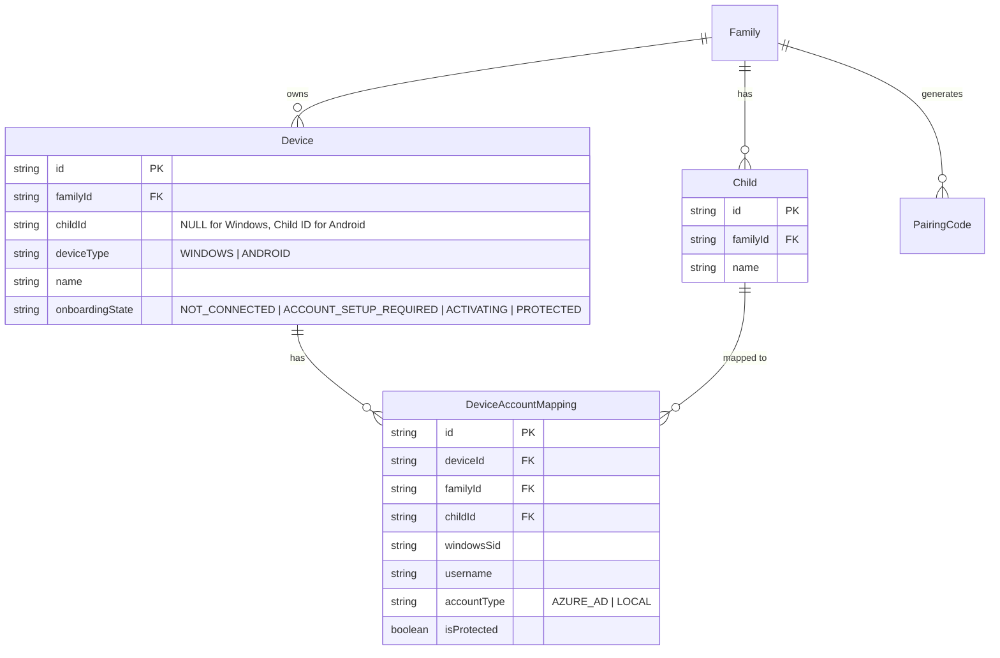
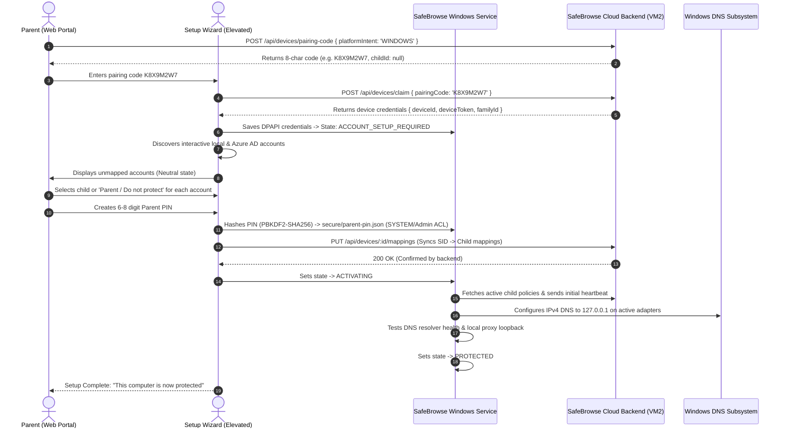

# SafeBrowse Stage C.5: Final Windows Family-Level Onboarding, Cloud Truth, Parent Lock & Child-Safe Management Report

**Date:** 2026-10-23  
**Classification:** **`READY FOR CLEAN FAMILY-LEVEL WINDOWS PHYSICAL VALIDATION`**  
*(Strict Notice: DO NOT classify as Pilot Ready until Cloud VM2 deployment, production migration reconciliation, and clean physical laptop validation succeed.)*  
**Branch:** `feature/stage11-step4-device-enforcement`  
**Git Baseline Commit:** `52517696e71c1c46fa481f1f9b780b8f8ccddf65`  
**Git Source Commit (HEAD):** `219779babb4db8f4c10beba8dbf0973bf075ba49`  
**GitHub Actions Build Run:** [#39956708077](https://github.com/dicanshulporwal-hub/safechild/actions/runs/39956708077) (SUCCESS)  
**Candidate Version:** `1.0.4-validation`  
**Windows MSI ProductVersion:** `1.0.4.7`  
**Android Release versionCode:** `5` (versionName `1.0.4-validation`)  
**Production Backend URL:** `https://safebrowse.porwal.online`  

---

## 1. Executive Summary

Stage C.5 finalizes the core architectural paradigm of SafeBrowse on desktop operating systems:
> **WINDOWS DEVICE BELONGS TO THE FAMILY.**  
> **WINDOWS ACCOUNTS BELONG TO SPECIFIC CHILDREN OR PARENTS.**

Previously, the system attempted to treat a Windows computer as bound to an individual child (`Device.childId`), which conflicted with modern household computer usage where a single physical machine (e.g. `LAPTOP-AAN0K715`) is shared among multiple family members (parents, Rahul, Manjari). This model led to severe UX confusion, state desynchronization, improper account preselection, missing parental locks, and unauthenticated localhost endpoints vulnerable to child tampering.

Stage C.5 resolves these defects across the entire stack:
1. **Family-Level Windows Device Model:** Windows devices are strictly family-owned (`Device.childId = null`). Child policies and tracking are derived exclusively through `DeviceAccountMapping` records (`windowsSid -> childId`). Android physical devices remain child-bound (`childId` populated).
2. **Platform-Aware Pairing Flow:** Parent Portal generates family pairing codes for Windows (`platformIntent: 'WINDOWS'`) without requiring prior child selection. The device immediately appears in the Parent Portal as "Setup Required" upon claiming.
3. **Zero Automatic Preselection:** Account discovery (`account-manager.ts`) presents all discovered local and Azure AD interactive accounts with a neutral state. The parent is required to explicitly assign each account to either a child profile or mark it as "Parent / Do not protect".
4. **SafeBrowse Parent PIN Lock:** Setup wizard requires the creation of a 6–8 digit Parent PIN. PIN verifiers are salted and hashed using PBKDF2-SHA256 (100,000 iterations) and stored in `secure/parent-pin.json` with strict SYSTEM/Administrators ACLs.
5. **Child-Proof Localhost Server Hardening:** Both GUI and Elevated Setup servers validate `Origin` / `Host` headers to prevent browser cross-origin attacks. Sensitive operations (`/api/disconnect`, `/api/reconfigure`, `/api/reconnect`, `/api/mappings`) strictly require an authenticated 5-minute management session token (`x-management-session`).
6. **Child-Safe Status Display:** Children can view basic protection indicators (`GET /api/status`), but sensitive hardware IDs, raw Windows SIDs, internal DNS proxy configurations, and administrative controls are redacted unless unlocked with the Parent PIN.
7. **Atomic 12-Step Disconnect & Teardown Transaction:** Parents can cleanly disconnect the device or reset the machine to `NOT_CONNECTED`, restoring system DNS to DHCP, flushing resolver caches, unpairing from the cloud, and clearing credentials and PIN verifiers.
8. **Automated CI PowerShell AST Parser Gate:** Added an automated validation gate in GitHub Actions verifying 0 syntax errors in the account discovery PowerShell script before WiX compilation.

---

## 2. Confirmed Defects & Architectural Root Causes

| Defect Observed | Physical Symptom | Root Cause | Stage C.5 Resolution |
|---|---|---|---|
| **Child-Bound PC Model** | Parent Portal forced picking one child when adding a PC, creating a single-child view for a shared device. | `Device.childId` was required and foreign keyed to `Child(id)` in PostgreSQL schema. | Decoupled `Device.childId` (nullable). Windows devices belong to `Family`. Account mappings bind `windowsSid -> childId`. |
| **Silent Preselection Hazard** | First child was auto-assigned to the primary Windows account without explicit parent choice. | `ElevatedPairServer` auto-populated mappings (`autoPreselect: true`). | Removed auto-preselection. All discovered accounts start unassigned; wizard blocks until all accounts are explicitly mapped. |
| **No Parent Protection Lock** | Any user (including a child) opening the GUI could click Disconnect, Reconnect, or change mappings. | No authentication layer existed on the local GUI HTTP server (`localhost:51173`). | Implemented PBKDF2-SHA256 Parent PIN manager. Disconnect, reconfiguration, and mapping edits require a valid session. |
| **Cross-Origin API Vulnerability** | Malicious web page visited by child could fetch `localhost:51173/api/disconnect`. | `GuiServer` did not validate request `Origin` / `Host` headers. | Enforced loopback Origin check. Rejects any non-local cross-origin request with 403 Forbidden. |
| **Data Leak in Status View** | Child could inspect device token, internal proxy port, cloud URLs, and raw SIDs. | `GET /api/status` dumped raw `device-config.json`. | Redacted sensitive technical details in child status view; full details revealed only with authenticated management token. |
| **Disconnection Drift** | Disconnecting left stale network DNS or orphaned cloud records. | Teardown sequence was non-transactional and partial. | Implemented 12-step atomic teardown transaction in `GuiServer` restoring DHCP DNS, purging credentials, and notifying cloud. |

---

## 3. Architecture & Data Flow

### 3.1. Entity Relationship Model (Family vs Device vs Child)



### 3.2. End-to-End Onboarding & Protection Lifecycle



---

## 4. Implementation Details

### 4.1. SafeBrowse Parent PIN Manager (`parent-pin-manager.ts`)
- **Key Derivation:** Uses PBKDF2 with SHA-256, 100,000 iterations, and a cryptographically secure 32-byte salt (`crypto.randomBytes(32)`).
- **Storage:** Persisted to `C:\ProgramData\SafeBrowse\secure\parent-pin.json` using Windows DPAPI or restrictive file permissions:
  ```powershell
  icacls "parent-pin.json" /inheritance:r /grant:r "NT AUTHORITY\SYSTEM:(F)" "BUILTIN\Administrators:(F)"
  ```
- **Management Sessions:** Verifying the PIN issues a cryptographically random in-memory session token (`mgmt_<hex>`, 32 bytes) valid for exactly 5 minutes.
- **Lockout Protection:** Invalid attempts trigger rate-limiting; consecutive failures increment backoff.

### 4.2. Localhost Server Hardening (`gui-server.ts` & `elevated-pair-server.ts`)
- **Loopback Origin Gate:**
  ```typescript
  private isAllowedOrigin(originHeader: string | undefined): boolean {
    if (!originHeader) return true; // Direct local non-browser calls
    const parsed = new URL(originHeader);
    return parsed.hostname === '127.0.0.1' || parsed.hostname === 'localhost';
  }
  ```
- **Management Session Gate:** Privileged endpoints (`/api/disconnect`, `/api/reconfigure`, `/api/mappings`, `/api/reconnect`) require `x-management-session` header matching an active token in `ParentPinManager`.
- **Sanitized Child View:** `GET /api/status` without a management token returns only:
  - `status`: `'PROTECTED'` | `'ATTENTION_REQUIRED'` | `'NOT_CONNECTED'`
  - `deviceName`: Machine name
  - `activeUser`: Current logged-in user display name
  - `protectionActive`: boolean
  - `version`: Installed version
  - Redacts: `deviceId`, `familyId`, `deviceToken`, raw `windowsSid`, DNS proxy ports, and cloud endpoints.

### 4.3. Atomic 12-Step Disconnect & Teardown Transaction
Executing `POST /api/disconnect` (guarded by Parent PIN session):
1. Validates management session token.
2. Changes state to `DISCONNECTED`.
3. Calls backend `POST /api/devices/:id/unpair` with device authentication.
4. Restores Windows adapter DNS to DHCP / original configuration.
5. Flushes Windows DNS client resolver cache.
6. Stops local DNS proxy listener.
7. Stops local block page HTTP/HTTPS server.
8. Deletes `profile-mappings.json`.
9. Deletes `device-config.json` (DPAPI machine credentials).
10. Clears Parent PIN verifier from `parent-pin.json`.
11. Invalidates all active in-memory management sessions.
12. Resets state machine to `NOT_CONNECTED`.

---

## 5. Verification & Test Evidence

### 5.1. Automated Test Suites Summary
All automated test suites pass across all workspaces with zero regressions:
- **`agent-windows`:** **16 of 16 test suites passed** (100% success rate).
  - `family-onboarding-and-pin.test.ts` (NEW): Full PIN hashing, verification, lockout, session token TTL, and privilege gating tests.
  - `recovery-and-hardening.test.ts`: Localhost CSRF protection, Origin validation, sanitized child status, and atomic teardown tests.
  - `unified-onboarding-wizard.test.ts`: 8-character canonical code claiming, zero preselection mapping, and PIN setup.
  - `account-manager.test.ts`, `block-server.test.ts`, `config-manager.test.ts`, etc.: All passed.
- **`backend`:** **48 of 48 test suites passed (262 tests)**.
  - `pairing-code-consistency.test.ts`: Family-level Windows pairing codes (`childId: null`, `platformIntent: 'WINDOWS'`).
  - `device-management-pilot.test.ts`: Account mapping sync, verification without childId, device deletion, and status transitions.
  - `device-policy-auth.test.ts`: Smart child policy resolution fallback for shared family PCs.
  - `cors-and-proxy-hardening.test.ts`: Production security and proxy headers.
  - `postgres-e2e.test.ts`: Database tenancy, triggers, and foreign keys.
- **TypeScript Typecheck:** 0 errors across `@safebrowse/shared`, `@safebrowse/protocol`, `@safebrowse/backend`, `@safebrowse/agent-windows`, and `@safebrowse/parent-web`.

### 5.2. CI Workflow & PowerShell AST Gate
- Workflow `.github/workflows/build-windows-msi.yml` executes:
  ```powershell
  [System.Management.Automation.Language.Parser]::ParseInput($scriptText, [ref]$tokens, [ref]$errors)
  ```
  Asserts `errors.Count -eq 0` prior to running WiX toolset v4 compilation.

---

## 6. Build Artifacts & Provenance

All validation binaries and installation packages have been built cleanly on GitHub Actions Windows runners ([Run #39956708077](https://github.com/dicanshulporwal-hub/safechild/actions/runs/39956708077)) with ProductVersion `1.0.4.7` and recorded in `release/VALIDATION_PROVENANCE.json` and `release/SHA256SUMS-validation.txt`:

| Artifact | Size (bytes) | SHA-256 Checksum | Target Platform |
|---|---|---|---|
| **`SafeBrowseChild-Validation.msi`** | 23,470,080 | `bfe6662f72c130cf95e64a70ffe1a805f879226988e5be50830300a6066d06da` | Windows 10/11 x64 Installer |
| **`SafeBrowseChild-Validation.exe`** | 73,198,080 | `7fb7d074c69c729fd0c9efb2e3ff96e497618492b3767a7dbdeb070b8ffb9caa` | Single Executable Agent |
| **`SafeBrowseServiceHost.exe`** | 37,888 | `40073d34e29be04a2e90b961da46d7d7e941f5816f0c23ab4c7b69e3e90137bb` | Windows Service Host (.NET 4.8) |
| **`SafeBrowseUserHelper.exe`** | 7,168 | `2fc74e2340ce1b6bb0e889c9f24fd80767f204aa785ffef24cb7433ed1347e10` | User Session Helper |
| **`SafeBrowseChild-Validation-1.0.4.apk`** | 5,641,147 | `42e782c1de57e4e78e5e85f80ed002e73e54a7fca50eb02699a7d4af46539e9d` | Android Pilot Release |

Manifest Verification:
```
42e782c1de57e4e78e5e85f80ed002e73e54a7fca50eb02699a7d4af46539e9d  release/android/SafeBrowseChild-Validation-1.0.4.apk
bfe6662f72c130cf95e64a70ffe1a805f879226988e5be50830300a6066d06da  release/windows-validation/SafeBrowseChild-Validation.msi
7fb7d074c69c729fd0c9efb2e3ff96e497618492b3767a7dbdeb070b8ffb9caa  release/windows-validation/SafeBrowseChild-Validation.exe
40073d34e29be04a2e90b961da46d7d7e941f5816f0c23ab4c7b69e3e90137bb  release/windows-validation/SafeBrowseServiceHost.exe
2fc74e2340ce1b6bb0e889c9f24fd80767f204aa785ffef24cb7433ed1347e10  release/windows-validation/SafeBrowseUserHelper.exe
```

---

## 7. Operational Guidelines & Next Steps

1. **Pre-Production Cloud DB Migration:** Before pointing test laptops to production VM2, the unified schema reconciliation migration (`20261023120000_stage_c5_family_device_model`) must be applied to VM2 database.
2. **Physical Laptop Testing Checklist:**
   - [ ] Clean install of `SafeBrowseChild-Pilot.msi` (ProductVersion `1.0.4.7`).
   - [ ] Verify DNS remains DHCP (`ipconfig /all`).
   - [ ] Generate 8-character pairing code in Parent Portal under "Add Windows Computer".
   - [ ] Complete setup wizard with explicit account mapping and Parent PIN creation.
   - [ ] Verify adapter DNS switches to `127.0.0.1` and state reports `PROTECTED`.
   - [ ] Open GUI as child: verify disconnect is locked behind Parent PIN.
   - [ ] Test Parent PIN unlock and verify 5-minute session timeout.
